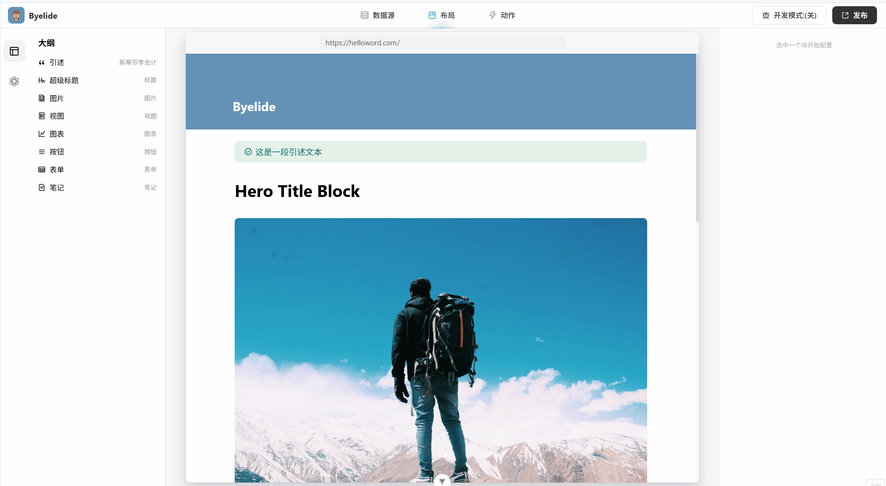
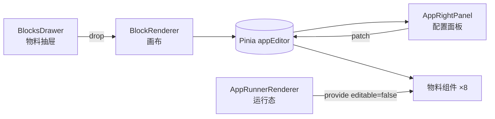

# Byelide · 低代码页面搭建平台



物料驱动的内容型页面搭建平台，覆盖物料、编排、配置、出码与运行时渲染五个环节。

---

## 这是什么

面向运营与产品人员，用拖拽与表单配置替代手写代码，完成内容型页面（介绍页、活动页、数据展示页）的搭建。

目前已实现 8 类物料、3 层嵌套路由与 4 个功能页：布局编辑、数据源、流程编排、运行时预览。

**不包含**发布、版本管理与权限体系，这三项属于平台级能力，不在本项目范围内。

## 演示

| 布局编辑：拖入物料、画布排序、右侧配置 | 数据源：Vue 内嵌 React 虚拟滚动表格 |
|---|---|
|  |  |

| 流程编排：三类节点、连线、白名单出码 |
|---|
|  |

## 快速开始

```bash
pnpm install
pnpm dev        # http://localhost:5173
pnpm build      # vue-tsc 类型检查 + vite build
pnpm preview    # 预览构建产物
```

Node 版本建议与 `@types/node@^24` 匹配。

## 技术要点

**一、物料协议与注册装配**
以 TypeScript 可辨识联合定义 8 类物料的 props 契约，`switch (block.type)` 时类型自动收窄，契约错误在编译期即被拦截。物料经注册中心统一装配，通过 `provide` 与 `globalProperties` 双通道暴露；每个物料只接收一个协议对象，新增物料无需改动渲染器。编辑器状态收敛到单一 Pinia store，配置面板以补丁形式回传，由外壳合并。

**二、拖拽编排与运行态复用**
为命令式拖拽库 smooth-dnd 自建 Vue 适配层：自定义 `render` 函数、不接管被拖元素 DOM、卸载时调用 `dispose`。在此基础上实现物料抽屉的复制拖入、画布内排序与跨容器拖入。编辑器与运行态复用同一套物料，运行态经 `provide/inject` 注入只读标记，禁用拖拽与工具栏。

**三、出码与构建治理**
流程编排出码执行白名单转换：剔除画布内部字段，按节点类型裁剪配置，输出 `{ version, nodes, edges }`。构建侧将 Vue 运行时、流程画布、图表与校验库拆为 4 组 vendor，图表渲染器改为异步组件，页面路由改为懒加载。

## 架构



```
src/
├── blocks/              物料：协议的具体实现
│   ├── basic/           quote / heroTitle / image / view / chart
│   └── external/        button / form / notes
├── components/
│   ├── AppLeftPanel/    物料抽屉 + 大纲
│   ├── AppPreviewer/    设备模拟器
│   ├── AppRightPanel/   配置面板 + Schema 预览
│   ├── AppRunnerRenderer/ 运行时根
│   ├── Flow/            流程画布 / 检查器 / 出码
│   └── SmoothDnd/       smooth-dnd 的 Vue 封装
├── stores/              appEditor / env
├── types/block.ts       物料协议（可辨识联合）
├── setup.ts             物料注册中心
└── views/               四个功能页
```

## 性能数据

构建产物实测（`pnpm build` 输出的 gzip 数值）：

| 指标 | 优化前 | 优化后 |
|---|---|---|
| 入口 chunk | 231.32 KB | **7.17 KB** |
| 首帧阻塞资源 | 231.32 KB | **63.5 KB** |
| 产物总量 | 480 KB | 466 KB |

按需 chunk：ECharts 173.92 KB、流程画布 68.83 KB、React 数据表格 134.20 KB，均不在首屏。

**说明**：入口降幅 97%，但产物总量基本不变（480 → 466 KB）。分包只改善缓存粒度，首屏下降来自 `defineAsyncComponent` 与路由懒加载——两者常被混为一谈，这里按实际分别列出。

## 设计取舍

**为什么拆包后首屏反而变大。**
首次分包后首屏体积未降反升，并多出一个预加载 chunk。原因是分组规则默认递归收集依赖，把 Vue 运行时卷入了图表分组，入口 chunk 因此反向依赖图表 chunk。关闭依赖递归、显式拆出 Vue 公共分组、以优先级控制归属后，图表恢复为按需 chunk。

**为什么在 Vue 里嵌 React。**
数据源页需要百万行虚拟滚动，`glide-data-grid` 是现成且成熟的方案。以 `createRoot` 挂载、`unmount` 卸载、`ResizeObserver` 同步尺寸，代价是引入两个运行时，收益是不重复造轮子。

**为什么出码只到 Schema。**
`SchemaExporter` 展示当前选中块的 JSON 并支持复制；流程侧输出白名单裁剪后的 `{ version, nodes, edges }`。生成可运行的组件代码需要模板引擎与代码生成器，属于另一个量级的工作，因此未做。

## 已知边界

- 数据源页为本地模拟数据（5 条列表 + 100 万行生成数据），未接后端接口
- 「发布」按钮仅有界面，无实际逻辑
- 出码输出 Schema，不支持导入回填
- 「视图」物料内嵌自研 canvas 表格，固定列宽与行高、1 万行，定位为技术验证

## 技术栈

Vue 3.5 · TypeScript · Vite 8（Rolldown）· Pinia · vue-router · smooth-dnd · ECharts · vee-validate · @vue-flow · React 18 + glide-data-grid（仅数据源页）